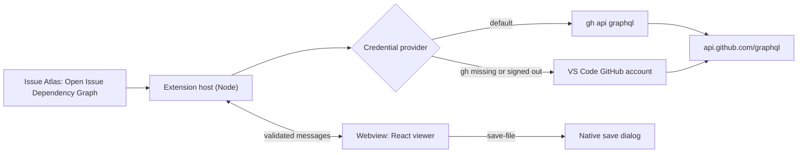

# VS Code extension

## Purpose

The VS Code extension hosts the same viewer in an editor tab, so issue dependencies can be read next to the code that implements them. It adds no graph features. It changes three things: who authenticates, who talks to GitHub, and how files are saved.

## Delivery shape



| Concern | Hosted page | VS Code extension |
| --- | --- | --- |
| Credential | Fine-grained token typed into the dialog | GitHub CLI, or the VS Code GitHub account; no token field |
| GitHub requests | Browser `fetch` | Extension host, through `gh` or `fetch` |
| Webview network access | `connect-src` GitHub only | `connect-src 'none'` |
| Repository memory | `?repo=` query | Webview state, restored after a VS Code restart |
| Exports | Browser download | Native save dialog and `workspace.fs` |
| Color mode | Operating system | Active VS Code theme kind |

The viewer receives these differences through `ViewerPlatform` (`src/platform/types.ts`). `src/platform/browser.ts` implements the hosted page; `src/platform/vscode.ts` implements the webview. Components and domain modules do not know which one is active.

## Module boundaries

```text
extension/
├── package.json            # VS Code manifest; version matches the root package
├── README.md               # Marketplace description
└── src/
    ├── extension.ts        # activation, command, panel serializer, settings, Git remotes
    ├── panel.ts            # webview lifecycle, request routing, exports
    ├── credentials.ts      # provider selection and GitHub CLI fallback
    ├── github-cli.ts       # gh api graphql transport
    ├── messages.ts         # Zod schema for webview messages
    ├── remotes.ts          # github.com repositories from Git remotes
    ├── repository-stream.ts# snapshot-to-page-delta conversion
    └── webview-html.ts     # document template and CSP
src/
├── github/transport.ts     # GraphQlTransport contract and token transport
├── platform/               # ViewerPlatform contract, browser and webview platforms, protocol
└── webview.tsx             # webview entry
```

`extension/src` may import from `src/github`, `src/domain`, and `src/platform`. Nothing in `src` imports from `extension/src`, and only `extension/src` imports `vscode`. Pure modules (`credentials`, `github-cli`, `messages`, `remotes`, `repository-stream`, `webview-html`) do not import `vscode`, so unit tests cover them directly.

## GraphQL transport

`fetchRepositorySnapshot` and `fetchIssueBody` take a `GraphQlTransport` instead of a token. A transport sends one GraphQL document and resolves with the decoded envelope; the client keeps envelope checks, Zod validation, and pagination.

- `tokenTransport(token)` is the original `fetch` implementation, used by the hosted page and by the VS Code account provider.
- `githubCliTransport` runs `gh api graphql --hostname github.com --input -` without a shell and writes `{query, variables}` to stdin. `gh` exit code 4 (authentication required) and a missing executable raise `GitHubCliUnavailableError`. HTTP failures are read from gh's `(HTTP nnn)` suffix and reported as `GitHub returned HTTP nnn.` GraphQL errors in stdout follow the shared rejection path. gh output is never placed in an error message.

## Credential selection

`issueAtlas.authentication.provider`:

| Value | Behavior |
| --- | --- |
| `auto` | Use GitHub CLI. On `GitHubCliUnavailableError`, switch to the VS Code account for the rest of that repository session. Other failures are reported, not retried. |
| `githubCli` | Use GitHub CLI only. |
| `vscode` | Use `vscode.authentication.getSession('github', ['repo'], { createIfNone: true })` only. |

A new transport is created for every repository load, so setting changes and a newly signed-in gh take effect on the next load. The VS Code account is requested lazily and requested again after a cancelled sign-in.

Detection does not use `gh auth token`. In testing it returned a keyring token while `gh api` reported that no account was configured, so the transport relies on the result of the request it actually makes.

## Message protocol

The webview renders repository-controlled Markdown, so the host treats it as untrusted. `extension/src/messages.ts` validates every incoming message and drops anything else:

| Webview → host | Host → webview |
| --- | --- |
| `load-repository {requestId, repository}` | `repository-page {requestId, progress, snapshot, issues}` |
| `load-issue-body {requestId, repository, number}` | `repository-loaded {requestId}` |
| `cancel {requestId}` | `issue-body {requestId, body}` |
| `save-file {file}` | `request-failed {requestId, message}` |
| `repository-changed {repository}` | |

Repository names are re-parsed by the host. Export names must match `^[\w.-]{1,160}\.(json|svg|png)$`, which excludes path separators. `repository-page` carries only issues added since the previous page, so a large repository is not resent cumulatively.

## Webview document

The host generates the document (`webview-html.ts`) with a fresh nonce per panel:

- `default-src 'none'`; scripts only with the nonce or from `webview.cspSource`; styles from `cspSource` plus the inline styles Primer needs; images from `cspSource`, `data:`, and the two GitHub hosts; `connect-src 'none'`.
- Configuration is a JSON data block with `<`, `>`, `&`, U+2028, and U+2029 escaped.
- `localResourceRoots` is limited to `extension/dist/webview`.
- `retainContextWhenHidden` keeps a loaded graph while the tab is hidden, instead of reloading it from GitHub on every tab switch.

`vite.webview.config.ts` builds `src/webview.tsx` into `extension/dist/webview` with stable `webview.js` and `webview.css` names. The webview entry imports protocol types only, so Zod stays out of its bundle.

## Workspace integration

The command reads remotes from the built-in Git extension. One github.com repository loads immediately; several open a picker with `upstream` first; none opens the demo. Local-path and non-github.com remotes are ignored.

`issueAtlas.githubCli.path` is machine-scoped, so a workspace cannot redirect the extension to an executable it controls. The extension declares support for untrusted workspaces: it executes only the user-configured `gh`, and the Git extension is unavailable in restricted mode.

## Compatibility

`engines.vscode` is `^1.90.0`, the first release whose extension host runs Node 20 with global `fetch`. `@types/vscode` is pinned to the same version because `vsce` rejects types newer than `engines.vscode`; this is the documented exception to the latest-release version policy.

## Acceptance criteria

- No token field is shown in VS Code, and no credential reaches the webview.
- With gh signed in, repository and body requests run through `gh api graphql`.
- With gh missing or signed out, `auto` asks for the VS Code GitHub account once.
- Exports open a save dialog and write the chosen file.
- The webview follows the VS Code theme kind and reports no CSP violations.
- Malformed or unexpected webview messages have no effect.
- `bun run package:vscode` produces a VSIX without source maps.
